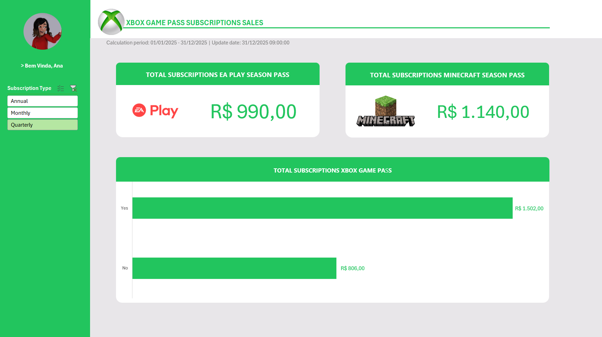

# Dashboard de Vendas do Xbox

## 📌 Sobre o projeto

Projeto de criação de um dashboard de vendas do Xbox no Excel, com foco na organização e visualização de dados. O objetivo é transformar dados brutos em informações visuais claras, facilitando a análise de desempenho das vendas e apoiando a tomada de decisões baseada em dados.

## 🎯 Objetivos

- Organizar e visualizar dados de vendas.
- Apresentar indicadores de desempenho de forma clara e intuitiva.
- Facilitar a análise dos resultados por meio de um dashboard.

## 🛠️ Ferramentas utilizadas

- Microsoft Excel
- Gráficos e visualização de dados
- Organização e análise de dados

## 📊 Indicadores apresentados

- Total de assinaturas do EA Play Season Pass.
- Total de assinaturas do Minecraft Season Pass.
- Comparação de vendas por categoria.
- Filtro por tipo de assinatura: anual, mensal e trimestral.

## 🖼️ Visualização do dashboard

## 📥 Baixe o dashboard

[**Clique aqui para baixar o arquivo Excel**](dashboard-vendas-xbox.xlsx)
